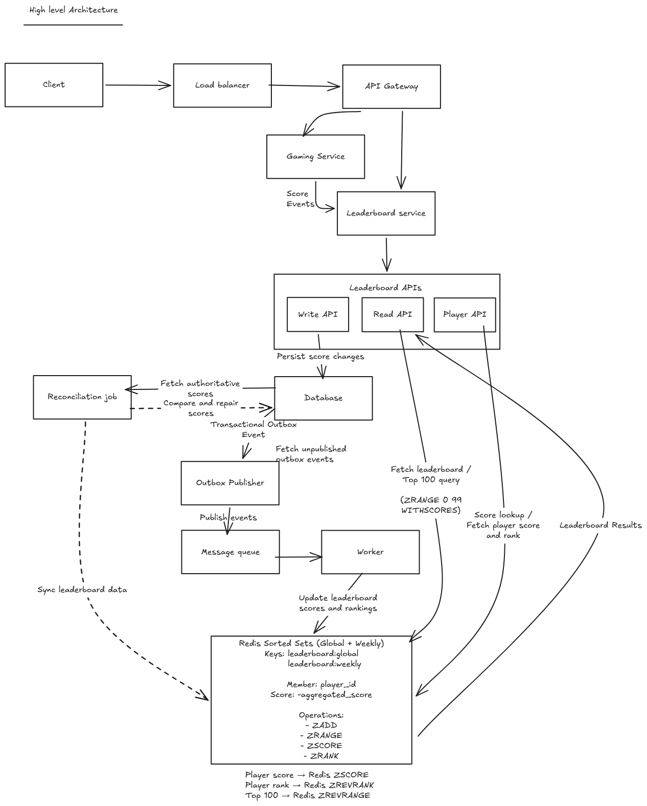

# Design a Leaderboard System

Design a Leaderboard System like the one used in an online gaming platform.

## 1. Clarifying Questions

| # | Clarification Question | Assumption / Interviewer Answer |
| --- | --- | --- |
| 1 | Is the leaderboard updated live or only after a game finishes? | Leaderboard should be continuously updated as score events arrive. |
| 2 | When should the leaderboard reset? Daily, weekly, monthly or never? | Support both Global (lifetime) and Weekly leaderboards. |
| 3 | How many top players should the leaderboard display? | Support Top 100 players. |
| 4 | Are we designing only a distributed counter or both counter and leaderboard functionality? | Design both score counters and ranking functionality. |
| 5 | Can player scores increase and decrease? | Both increment and decrement operations should be supported. |
| 6 | How should players with equal scores be ranked? | Assume alphabetical ordering for equal scores, providing unique positions. |
| 7 | Should the system maintain detailed player statistics? | No. Gaming Service owns player profiles and detailed statistics. Leaderboard Service owns scores and rankings. |

## 1.1 Functional Requirements

1. The system should maintain player scores using increment and decrement operations.
2. The system should continuously update player scores when new score events arrive.
3. The system should support Global and Weekly leaderboards.
4. Users should be able to retrieve the Top 100 players.
5. Users should be able to retrieve their current rank.
6. Users should be able to view their own score.
7. The system should maintain correct rankings whenever scores change.
8. Players with equal scores should be ordered using a deterministic tie-breaking rule (assumption: alphabetical order).

### Out of Scope

- Player profiles and account management.
- Match management and game execution.
- Detailed player statistics (wins, losses, matches played, etc.).
- Live game score tracking.

These responsibilities belong to the Gaming Service.

## 1.2 Non-Functional Requirements

1. **High Availability:** The leaderboard should remain accessible despite component failures.
2. **Scalability:** Support millions of users and increasing read/write traffic.
3. **Burst Handling:** Handle sudden traffic spikes during weekends and gaming events.
4. **Low Latency:** Leaderboard reads and score updates should be fast.
5. **Durability:** Accepted score updates must not be lost, even during failures.
6. **Correctness:** Prevent lost updates and duplicate score application.
7. **Ranking Consistency:** Maintain correct ordering when player scores change.
8. **Read Freshness:** Slightly stale leaderboard reads are acceptable (initial assumption: 1–5 seconds).

### Important Trade-offs

- Write correctness and durability are critical.
- Leaderboard reads can tolerate eventual consistency.
- Availability and correctness must be carefully balanced during failures.

## 2.Scale Estimations

### Assumptions

- Total registered users  - 10M
- Daily active users - 1M
- Write updates (request) per day = 5
- Peak traffic multiplier -  10X
- Read updates/day - 100

### 2.1 Write Estimation

- Total write request -  1M * 5 = 5M
- Average QPS - 5000000/86400 = 58 QPS
- Peak Write QPS = 58*10 = 580 QPS

### 2.2 Read Estimation

- Total read request -  1M * 100 = 100M
- Average QPS - 100000000/86400 = 1157 QPS
- Peak Read  QPS = 1157*10 = 11570 QPS

**Read-to-write ratio is approximately 20:1.**

### 2.3 Storage Estimations

- Assume each record has 1KB size
- Two leaderboard types: Global and Weekly.
- Raw storage size - 1000*10000000*2  = 20 GB

Note: This excludes indexes, replication overhead and historical score events.

## 3. API Design

### 3.1 Submit Score Updates API

**Request:**
**POST**`/v1/scores/batch`

```json
{
    "game_id": "G01",
    "batch_id": "B01",
    "events": [
        {
            "event_id": "E01",
            "player_id": "P01",
            "score" : 50
        },
        {
            "event_id": "E02",
            "player_id": "P02",
            "score" : 90
        }
    ]
}
```

**Response:**

HTTP 202 Accepted

```json
{
    "batch_id": "B01",
    "status": "ACCEPTED",
    "message": "Score events accepted for processing"
}
```

**Design Considerations:**

- Batch score updates to reduce request overhead.
- Use unique event IDs for idempotency and duplicate prevention.
- Support positive and negative score deltas.
- Durably accept events before returning HTTP 202.
- Process events asynchronously to handle traffic bursts and decouple score ingestion from leaderboard updates

### 3.2 Get Top 100 Players API

**Query Parameters:**

- `type`: Leaderboard type (global/weekly).
- `limit`: Number of players to retrieve (default: 100).
- `cursor`: Opaque pagination cursor.
- `snapshot_id`: Identifies the leaderboard snapshot for consistent pagination.

**First Request:**
**GET** `/v1/leaderboard?type=global&limit=100`

**Response:**

```json
{
    "snapshot_id": "S101",
    "players": [
        {
            "player_id": "P01",
            "score": 1000,
            "rank": 1
        }
    ],
    "next_cursor": "C101" 
}
```

**Next page request:**

**GET** `/v1/leaderboards?type=global&limit=100&snapshot_id=S101&cursor=C101`

**Design Considerations:**

- Use cursor-based pagination instead of offset-based pagination.
- Use snapshot-based pagination to maintain a consistent view across pages.
- Subsequent page requests should use the same snapshot ID.
- A refresh should create a new snapshot to retrieve the latest leaderboard.
- Snapshots should have a limited retention period.
- Snapshot metadata alone does not guarantee consistent pagination.
- A consistent snapshot requires immutable ranking data or an equivalent versioned pagination mechanism.
- Snapshot storage has additional memory/storage costs and can be introduced based on pagination consistency requirements.

### 3.3 Get Player's Rank and Score API

**Request:**
**GET** `/v1/players/{player_id}/leaderboard`

**Response:**

```json
{
    "player_id": "P01",
    "leaderboards": {
        "global": {
            "score": 500,
            "rank": 250
        },
        "weekly": {
            "score": 300,
            "rank": 12
        }
    },
    "updated_at": "2026-10-31T19:18:00"
}
```

**Design Considerations:**

- Retrieve Global and Weekly rankings in a single request.
- Return the player's aggregated score and current rank.
- Avoid fetching individual game history or score events.
- Return the last updated timestamp to communicate data freshness.

### 3.4 Internal Operations

- Weekly leaderboard uses period-specific Redis keys.

```text
Example: leaderboard:weekly:2026-W45.
```

- A new weekly period creates a new leaderboard key.
- The Global leaderboard remains unaffected.
- Old weekly leaderboard keys can expire based on retention policy.
- Scheduled transitions must ensure incoming events are assigned to the correct period.

## 4. Data Modelling

### 4.1 Player Leaderboard

Stores the aggregated score of each player.

Fields:

- player_id
- leaderboard_type (GLOBAL / WEEKLY)
- period_id
- version
- score
- created_at
- updated_at

**Constraints:**

- Unique constraint on (player_id, leaderboard_type, period_id).
- Rank is derived using score ordering.
- Ordering: score DESC, player_name ASC.

### 4.2 Processed Score Events

Stores individual score events to prevent duplicate processing.

Fields:

- event_id (Unique)
- game_id
- player_id
- score_delta
- processing_status
- created_at
- processed_at

**Purpose:**

- Prevent duplicate score application.
- Track event processing status.
- Support retries and recovery.

### 4.3 Leaderboard Snapshot

Stores snapshot information for consistent pagination.

Fields:

- snapshot_id (Unique)
- leaderboard_type
- period_id
- created_at
- expires_at

**Purpose:**

- Maintain a consistent leaderboard view across pagination requests.
- Prevent duplicate or missing players when live rankings change.
- Snapshots should have a limited retention period.

### 4.4 Outbox (If Required)

Stores events that need to be reliably published to the message queue.

Fields:

- outbox_id
- event_id
- payload
- status
- created_at
- published_at

## 5. High level architecture

### Architecture Diagram



## 6. Deep Dives

### 6.1 Score Write Flow

1. Gaming Service sends score events to the Leaderboard Write API.
2. Write API persists the score event and Outbox record in the same SQL transaction.
3. API returns HTTP 202 only after durable persistence.
4. Outbox Publisher publishes pending events to Kafka and marks them as published.
5. Worker consumes events from Kafka.
6. Worker uses event IDs and database uniqueness constraints to prevent duplicate processing.
7. Score aggregation and marking the event as `PROCESSED` happen in the same SQL transaction.
8. SQL is the source of truth; Redis Sorted Sets maintain the derived leaderboard representation.
9. Worker updates Redis with the latest score and monotonically increasing version.
10. Redis rejects stale versions to prevent out-of-order overwrites.
11. Reconciliation compares SQL and Redis and repairs inconsistencies using authoritative SQL data.

**Core Principles:**

- SQL is the authoritative source of truth.
- Redis is a derived and recoverable representation.
- Event IDs provide idempotency.
- Database transactions provide atomicity.
- Versions protect against stale updates.
- Reconciliation repairs inconsistencies.

### 6.2 Redis Sorted Sets

Redis Sorted Sets maintain the leaderboard rankings.

- Key identifies a leaderboard (e.g. leaderboard:global).
- Member identifies a player.
- Score determines the ordering.
- Equal scores are ordered lexicographically by member.

For descending actual scores with alphabetical tie-breaking, one possible representation is:

- Store negative aggregated scores.
- Use player_name and player_id as the member.
- Use ZRANGE to retrieve highest actual scores first.

**Version-based Updates:**

- Redis ZADD does not automatically compare application versions.
- Use an atomic Lua script to compare the incoming version with the stored version.
- Apply the score update only if the incoming version is newer.
- This prevents stale worker updates from overwriting newer scores.

**Important commands:**

- ZADD: Add/update player.
- ZRANGE: Retrieve ascending order.
- ZREVRANGE: Retrieve descending order.
- ZSCORE: Retrieve player score.
- ZRANK: Retrieve ascending rank.
- ZREVRANK: Retrieve descending rank.
- ZINCRBY: Increment/decrement score.
- ZCARD: Get leaderboard size.
- ZREM: Remove player.

Redis ranks are zero-based; add 1 for display.

### 6.3 Leaderboard Read Flow

1. Client requests the Top 100 through the Leaderboard Read API.
2. Read API queries Redis Sorted Set.
3. Redis returns the Top 100 using ZRANGE 0 99 WITHSCORES.
4. Since negative aggregated scores are stored, highest actual scores appear first.
5. Read API converts stored scores back to actual scores and constructs the response.

**First-time initialization:**

- If the leaderboard key is missing, trigger background initialization.
- Fetch aggregated scores from SQL and populate Redis.
- Use a shared initialization lock/status to prevent duplicate initialization jobs.
- Serve stale data if available while refreshing.
- If no usable data is available, return a temporary 503 after a bounded wait.

SQL remains the source of truth; Redis serves leaderboard reads.

### 6.4 SQL Persistence and Source of Truth

- SQL is the authoritative source for aggregated player scores.
- Each player has an aggregated score for each leaderboard type and period.
- Redis maintains a derived Sorted Set for fast ranking and retrieval.
- The leaderboard can be reconstructed from SQL using player scores and tie-breaking rules.
- Historical score events are not required just to rebuild the current leaderboard.

SQL = Source of Truth
Redis = Derived Leaderboard Representation

### 6.5 SQL-to-Redis Update Processing

- Leaderboard Worker directly updates Redis after SQL aggregation.
- No additional Kafka topic is required at the current scale.
- SQL and Redis updates are not part of one atomic transaction.
- If Redis update fails, keep the projection update pending.
- Retry the Redis update using the latest SQL aggregated score and version.
- Mark the projection update successful only after Redis confirms it.

**Projection Recovery:**

- Maintain projection version/status in SQL to identify pending Redis updates.
- If a worker crashes after SQL commit but before Redis update, reconciliation can detect the missing projection.
- Retry using the latest aggregated SQL score and version.
- Do not reapply the original score delta during projection retries.

### 6.6 Reconciliation

- A background reconciliation job periodically compares SQL and Redis.
- SQL is the authoritative source.
- Process player records in batches. Compare aggregated scores and versions.
- If SQL has a newer version, update Redis.  If versions match, no repair is needed.
- If Redis has a higher version, re-read SQL before taking action.
- Reconciliation repairs missed or inconsistent Redis updates.
- Reconciliation should also detect missing Redis members, not just score/version mismatches.
- Redis projection updates must be version-aware and atomic.
- Reconciliation should process records in batches to avoid overloading SQL and Redis.

## 7. Bottlenecks and tradeoffs

### 7.1 Redis Bottlenecks and Scaling

- Redis Sorted Sets consume memory proportional to leaderboard size.
- A single leaderboard key can become a hot key.
- Redis Cluster distributes different keys across shards but does not automatically split one Sorted Set.
- Sharding distributes players across multiple Sorted Sets.
- Global Top 100 then requires querying each shard and merging local results.
- This introduces fan-out read latency and additional complexity.

Trade-off:
Start with one Sorted Set. Introduce sharding when Redis memory,CPU, throughput or latency becomes a measurable bottleneck.

### 7.2 SQL Bottlenecks

- Concurrent workers updating the same player can cause row contention. Use atomic SQL increments and database row-level locking.
- Celebrity players can create hot-row bottlenecks.Use batching/write coalescing to combine multiple score deltas.
- Preserve event-level idempotency when batching.
- Commit SQL transactions before acknowledging Kafka messages. If SQL fails, leave messages unacknowledged for retry.

Trade-off:
Batching reduces database writes but introduces processing latency and additional complexity.

### 7.3 Kafka Bottlenecks and Partitioning

- Kafka partitions determine consumer parallelism.
- Within one consumer group, only one consumer owns a partition at a time.
- More workers than partitions can leave workers idle.
- Use `player_id` as the Kafka message key to preserve per-player ordering.
- A celebrity player can create a hot partition.
- Batching reduces downstream SQL writes.
- Advanced bucketing can distribute hot-player traffic but introduces ordering, aggregation and idempotency complexity.

Trade-off:
Start with player_id partitioning. Introduce advanced bucketing only when partition skew becomes a measurable bottleneck.

### 7.4 Architecture Trade-offs

- SQL provides durability and correctness. Redis provides fast ranking and retrieval.
- Asynchronous processing improves scalability but introduces eventual consistency.
- Sharding improves write distribution but increases read complexity.
- Batching reduces SQL writes but introduces processing latency.

## 8. Reliability

### 8.1 SQL Failure

- SQL is the source of truth. If SQL becomes unavailable, Write API returns HTTP 503.
- Do not return HTTP 202 unless events are durably accepted.
- Circuit breaker prevents repeated requests to unhealthy database.
- Gaming Service retries with exponential backoff.
- Event IDs and SQL unique constraints prevent duplicate processing.
- After recovery, the circuit breaker allows requests again.

### 8.2 Redis Failure

- Database continues accepting and aggregating score updates.
- Failed Redis projection updates remain pending for retry.
- Do not reapply SQL score increments during Redis retries.
- Serve stale data when available.
- Use controlled SQL fallback to avoid overloading database.
- If Redis recovers, retry pending projection updates.
- Reconciliation compares DB and Redis versions and repairs inconsistencies.
- If Redis loses all data, rebuild Sorted Sets from authoritative SQL records.

### 8.3 Kafka Failure

- Score events and Outbox records are committed atomically in DB. Return HTTP 202 after successful SQL commit, even if Kafka is unavailable.
- Outbox Publisher retries unpublished records with exponential backoff.
- Pending Outbox records are retained until successfully published.
- Publisher crashes may cause duplicate Kafka messages. Consumer-side idempotency prevents duplicate score application.
- Kafka publishing and updating Outbox status are not atomic.
- Publisher may successfully publish an event but crash before marking it as published in SQL.
- The same event may therefore be published again.
- Consumer-side idempotency prevents duplicate score application.

### 8.4 Worker Crash and Duplicate Delivery

- Kafka provides at-least-once delivery.
- Worker may crash after DB commit but before Kafka acknowledgement. Kafka can redeliver the same event.
- Check event_id using a SQL unique constraint.
- Score aggregation and marking the event **PROCESSED** happen in one SQL transaction.
- Duplicate events are skipped without applying the score again.
- Acknowledge Kafka only after successful SQL commit.

### 8.5 Retries and DLQ

- Retry transient failures using exponential backoff.
- Configure a maximum retry count.
- Move repeatedly failing events to a Dead Letter Queue(DLQ).
- Invalid or permanently failing events should not be retried indefinitely.
- Alert operators when events enter DLQ. Support investigation and controlled replay after fixing the issue.

### 8.6 Redis Disaster Recovery

- SQL is the authoritative source of leaderboard scores. If Redis loses its data, trigger a background rebuild.
- Fetch aggregated scores from SQL in batches.
- Recreate Global and Weekly Sorted Sets.
- Use versions to prevent stale updates overwriting newer scores.
- Run reconciliation after rebuilding.
- Expose the leaderboard as ready only after initialization completes.

## 9. Observability

### Metrics

- API success/failure rate, latency and throughput.
- SQL query latency, connection pool usage and failures.
- Outbox pending count and oldest unpublished event age.
- Kafka consumer lag and throughput.
- Worker processing rate, failures and retries.
- Redis latency, memory and availability.
- End-to-end score processing latency.
- Leaderboard freshness.

### Logs and Tracing

- Structured logs with event_id, player_id and correlation_id.
- Track processing failures, retries and DLQ events.
- Distributed tracing across API, SQL, Kafka and workers.

### Alerts

- High API error rate.
- SQL latency and connection exhaustion.
- Growing Outbox backlog.
- High Kafka consumer lag.
- Worker failures.
- Redis unavailability.
- Leaderboard freshness violations.
- DLQ growth.
