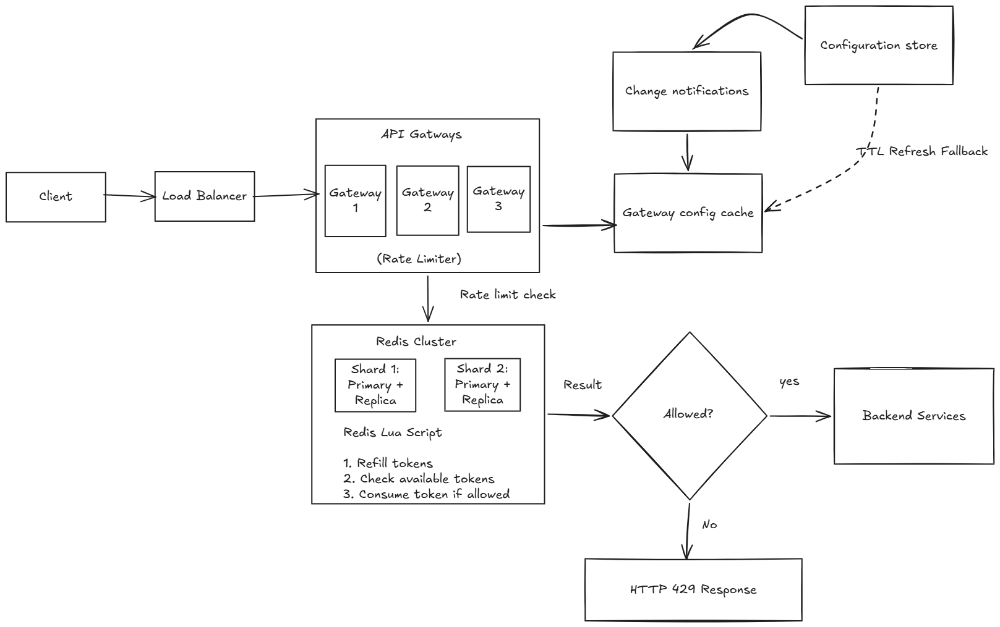

# Design a Rate Limiter

Design a rate limiter for a backend system that receives API requests from millions of users. The system should prevent clients from sending too many requests and protect our backend services from overload.

## 1. Clarifying Questions

### 1.1 Functional Requirements

- Rate limiter should allow or reject the request based on the limit configured.
- Should support different limit for different users.
- When rate limit is exceeded, should return HTTP 429 - Too many request error.
- Support different limits for different API endpoints.
- Support fixed-window counter resets; other algorithms follow their own state-update rules
- Rate limits should be configurable and updatable.
- It should support different limits, including requests per second, minute, and hour.
- Support configurable rate-limiting algorithms, such as fixed window, sliding window, and token bucket.

### 1.2 Non - Functional Requirements

- Low latency - Rate-limit checks should add minimal overhead to API requests.
- High availability - rate limiter should be available even though nodes or other components crashes
- Scalability and high throughput - Handle large request volumes and traffic bursts as the system grows.
- Correctness and consistency - Enforce configured limits accurately across distributed nodes, accounting for the chosen algorithm and acceptable overshoot.
- Fault tolerance -  Failure of one rate-limiter node should not affect the complete system.

## 2. Scale Estimation

### Assumptions

- Total users = 10 billion
- Daily active users - 10 million
- Peak - 10x
- Requests per active user per day  = 10
- Avg counter size = 100 bytes

### Traffic Estimation

- Total request per day = 10M*10 = 100M
- Average no of requests = 100M/86400 ~ 1157 QPS
- Peak QPS - 1157*10 = 11570 QPS

- Storage = 10M *100bytes = 1 GB
- Assume we have 5 API endpoints --> 5*1gb= 5GB

Memory provisioning: More than the raw estimate to account for overhead, replication, and headroom

## 3. API Design

### 3.1 Rate Limit Check API

**POST** `/rate-limit-check`

**Request**:

```json
{
    "client_id" : "Sanjana",
    "endpoint" : "get/users/{user_id}"
}
```

**Response: Allowed**
HTTP 200 OK

```json

{
    "status": "Allowed",
    "limit": 100,
    "remaining_quota": 55,
    "reset_after": 23
}
```

**Response: Rejected**
HTTP 429 Too many requests

```json

{
    "status": "Rejected",
    "limit": 100,
    "remaining_quota": 0,
    "retry_after": 12
}
```

## 4. Data Modelling

RateLimitConfig

- client_id
- endpoint
- limit
- window_duration
- algorithm (FIXED_WINDOW, SLIDING_WINDOW, TOKEN_BUCKET)

Defines the rate-limit policy for a client and endpoint.

RateLimitState

- client_id
- endpoint
- request_count
- window_start_time

**Redis Key:** rate_limit:{client_id}:{endpoint}

Stores the runtime counter for a client and endpoint combination. The state representation varies depending on the selected algorithm.

### 4.2 Storage: Redis

- Redis is used as an in-memory store for low-latency rate-limit checks.
- A **Redis Lua script** atomically checks the counter and increments it only if the request is allowed.
- TTL automatically expires counter keys when the fixed window ends.
- Set TTL when creating the counter; subsequent requests must not extend the fixed-window expiration.

### 4.3 Important Design Considerations

1. Counter isolation: Each client and endpoint combination has independent rate-limit state.
2. Atomicity: Check-and-increment must execute atomically to prevent concurrent requests from exceeding the configured limit.
3. Policy changes: State and configuration must remain compatible when a rate-limit policy changes.
4. Algorithm-specific state: Sliding-window and token-bucket algorithms require different state representations from a simple fixed-window counter.

### 4.4 Rate-Limiting Algorithms

#### 1. Fixed Window Counter

- Divide time into fixed windows, such as one minute.
- Maintain a request counter for each client and endpoint.
- Increment the counter for each allowed request.
- Reset the counter when the window expires using Redis TTL.
- Use an atomic Redis Lua script to check the limit and increment the counter.

**Advantages:**

- Simple to implement.
- Low memory usage.
- Fast counter updates.

**Disadvantages:**

- Boundary burst problem: clients can send nearly twice the configured limit across two consecutive windows.

#### 2. Sliding Window Log

- Store the timestamp of each request for a client and endpoint.
- When a request arrives, remove timestamps older than the configured window.
- Count the remaining timestamps.
- Allow the request if the count is below the configured limit; otherwise, reject it with HTTP 429.

**Advantages:**

- Accurately enforces the limit over a rolling time window.
- Avoids the fixed-window boundary burst problem.

**Disadvantages:**

- High memory usage because every request timestamp must be stored.
- Additional processing is required to remove expired timestamps and count recent requests.

#### 3. Sliding Window Counter

- Combines the previous fixed window's count and the current window's count.
- Estimates the number of requests in the rolling window by weighting the previous window's count based on how much of that window overlaps with the rolling window.
- Uses the current window's count directly.
- Stores window counters instead of individual request timestamps.

**Formula:**

```text
estimated_count =  previous_count * (1 - elapsed_fraction)  + current_count
```

Here, `elapsed_fraction` is the fraction of the current fixed window that has elapsed.

**Example:**

Previous window count = 80 requests.

Current window count = 40 requests.

Half of the current window has elapsed.

```text
estimated_count = 80 * (1 - 0.5) + 40
                = 40 + 40
                = 80 requests
```

**Advantages:**

- Lower memory usage than Sliding Window Log.
- Reduces the fixed-window boundary burst problem.
- Suitable for high-throughput APIs where small estimation errors are acceptable.

**Disadvantages:**

- Approximate count because it assumes requests were distributed uniformly within the previous window.
- Can overestimate or underestimate the actual rolling-window count.

#### 4. Token Bucket

- Each client has a bucket with a configurable maximum token capacity.
- Each incoming request consumes one token.
- Tokens refill at a configured rate, up to the bucket's maximum capacity.
- Allow the request if a token is available; otherwise, reject it with HTTP 429 or throttle it.
- Store the token balance and last-refill timestamp for each client and endpoint.
- Calculate elapsed refill time and update the token balance atomically, for example, using a Redis Lua script.

**Key Parameters:**

- `capacity`: Maximum number of tokens; controls burst size.
- `refill_rate`: Number of tokens added per second; controls the sustained request rate.

**Example:**

A bucket has a capacity of 100 tokens and a refill rate of 10 tokens/second.

- Initially, the bucket contains 100 tokens.
- After 100 requests, the bucket becomes empty.
- After 3 seconds, 30 tokens become available.
- After 20 seconds, the bucket can refill to its maximum capacity of 100 tokens.

**Advantages:**

- Allows short bursts up to the bucket's capacity.
- Controls the long-term request rate through the refill rate.
- Uses compact state rather than storing every request timestamp.
- Supports flexible rate-limiting policies.

**Disadvantages:**

- Requires atomic updates to handle concurrent requests correctly.
- Does not guarantee a strict maximum number of requests in every rolling time window.
- Requires choosing appropriate bucket capacity and refill rate.

#### 5. Algorithm Selection

- **Chosen algorithm:** Token Bucket.
- **Reason:** Allows short bursts while controlling the sustained request rate.
- **Implementation:** Store token balance and last-refill timestamp in Redis. Use an atomic Lua script to refill tokens, check availability, and consume a token.
- **Trade-off:** Allows bursts up to bucket capacity and does not guarantee a strict maximum over every rolling time window.
- **Alternative:** Leaky Bucket when smoothing traffic to a steady processing rate is the primary goal.

## 5. High level architecture

### Architecture Diagram



## 6. Deep Dives — Rate Limiter

### 6.1 Redis Latency and Gateway Scaling

**Problem:** Redis becomes slow, causing gateways to wait longer for rate-limit decisions.

**Approach:**

- Scale API gateways horizontally to handle more incoming requests.
- Monitor Redis latency and connection-pool saturation.
- Use bounded timeouts so gateways don't wait indefinitely.
- Scaling gateways alone won't solve a Redis bottleneck.

**Key takeaway:** Identify which component is saturated before scaling it.

### 6.2 Redis Replication, Failover, and Sharding

**Problem:** A single Redis instance cannot handle the entire workload and may become a single point of failure.

**Approach:**

- Use Redis primary-replica replication for redundancy.
- Use Redis Sentinel to detect primary failures and coordinate failover.
- Shard rate-limit keys across Redis nodes to distribute load.

**Trade-offs:**

- Asynchronous replication can lose recently acknowledged writes during failover.
- Sharding distributes load, but a hot key can overload one shard even when others are idle.

### 6.3 Hot Keys and Uneven Shard Load

**Problem:** A very active client repeatedly accesses the same rate-limit key, overloading its assigned shard.

**Why it happens:**

- A key derived from `client_id + endpoint` consistently maps to the same shard.
- Requests for that key cannot be distributed freely without coordinating the shared rate-limit state.

**Possible approaches:**

- Apply stricter limits to abusive clients.
- Use local or hierarchical rate limiting where approximate global enforcement is acceptable.
- Carefully evaluate key-splitting approaches because independent counters can weaken the global limit.

**Key takeaway:** Sharding distributes different keys; it does not automatically distribute traffic for one hot key.

### 6.4 Redis Timeouts, Retries, and Idempotency

**Problem:** A Redis operation may succeed even when the gateway times out waiting for its response.

**Example:**

1. Gateway sends a rate-limit check.
2. Redis consumes a token.
3. The response is delayed or lost.
4. Gateway retries the operation.
5. Another token may be consumed.

**Approach:**

- Use bounded timeouts and retries.
- Avoid blindly retrying operations with uncertain outcomes.
- Consider request IDs and deduplication if preventing duplicate consumption justifies the added complexity.

**Key takeaway:** A timeout does not prove that an operation failed.

### 6.5 Configuration Caching and Stale Policies

**Problem:** A gateway continues enforcing an old rate-limit policy after an administrator changes it.

**Approach:**

- Cache policies locally to avoid a configuration-store lookup on every request.
- Publish change notifications to refresh or invalidate cached policies.
- Use TTL as a fallback when notifications are missed.
- Attach policy versions to identify configuration changes.
- Use periodic polling or revalidation to detect missed notifications before TTL expiry.

**Trade-offs:**

- Local caching improves latency and reduces configuration-store load.
- Notifications may be missed or delayed.
- Polling improves detection but adds read traffic.
- TTL bounds cache lifetime but does not guarantee immediate policy updates.

**Key takeaway:** Version numbers identify policy versions, but gateways need a mechanism to discover newer versions.

### 6.6 Redis Unavailability: Fail-Open vs. Fail-Closed

**Problem:** Gateways cannot access the shared rate-limit state when Redis is unavailable.

**Fail-open:**

- Allow requests, potentially using local emergency limits.
- Improves availability.
- Independent gateway-local counters cannot guarantee a strict global limit.

**Fail-closed:**

- Reject requests when the global limit cannot be verified.
- Protects the backend from uncontrolled traffic.
- Can reject legitimate requests during an infrastructure failure.

**Decision:** Choose based on endpoint criticality, backend health, and availability requirements. Different endpoints may need different policies.

## 7. Bottlenecks & Trade-offs

### 7.1 Identifying and Resolving Bottlenecks

**Problem:** Increased traffic can saturate different components of the rate-limiting system.

**Common bottlenecks and solutions:**

- **API Gateway CPU saturation:** Scale gateways horizontally to distribute incoming traffic.
- **Redis saturation:** Investigate CPU usage, command throughput, network latency, and connection-pool utilization. Scale or shard Redis when appropriate.
- **High Redis call latency:** Measure gateway-observed latency, Redis execution time, network round-trip time, and connection-pool wait time to isolate the cause.
- **Connection-pool exhaustion:** Use bounded connection-acquisition timeouts and monitor pool utilization and wait time.
- **Uneven shard load:** Investigate hot keys and shard distribution before adding capacity.

**Key takeaway:** Identify the saturated component before scaling. Scaling gateways alone will not resolve a Redis bottleneck.

### 7.2 Centralized vs. Local Rate Limiting

**Centralized rate limiting:**

- Gateways share rate-limit state through Redis.
- Provides shared-state enforcement across gateways, subject to Redis consistency and failover behavior.
- Adds network latency and Redis processing overhead to rate-limit checks.

**Local rate limiting:**

- Each gateway maintains its own rate-limit state.
- Reduces Redis traffic and network latency.
- Can continue making rate-limit decisions when Redis is unavailable.
- Independent gateway counters or token buckets can allow aggregate traffic to exceed the configured global limit.

**Trade-off:** Centralized limiting improves global coordination, while local limiting improves latency and resilience at the cost of global accuracy.

**Possible compromise:** Use hierarchical rate limiting or allocate token quotas to gateways. This reduces Redis calls but requires careful quota allocation and can leave unused capacity stranded on individual gateways.

### 7.3 Scaling Gateways vs. Redis

- Scale **API gateways** when gateway CPU, memory, connection handling, or request-processing capacity is the bottleneck.
- Scale or shard **Redis** when Redis processing capacity, throughput, or memory is the bottleneck.
- Add **Redis replicas** primarily for redundancy and eligible read workloads. Replicas do not automatically distribute token-consumption writes because these must be coordinated through the primary.
- Consider **local or hierarchical rate limiting** when Redis overhead becomes significant and some additional complexity or approximation is acceptable.

**Key takeaway:** Scale the component that is saturated, and verify that the change does not shift the bottleneck elsewhere.

### 7.4 Rate-Limit Accuracy vs. Availability

**Problem:** Strict enforcement requires access to shared rate-limit state, but shared-state infrastructure can become unavailable.

**Strict enforcement:**

- Route rate-limit decisions through shared Redis state.
- Provides coordinated enforcement across gateways under normal operation.
- Depends on Redis availability and the consistency guarantees of the deployment.
- Failover or network partitions can still cause temporary inaccuracies.

**Availability-oriented enforcement:**

- Allow requests when Redis is unavailable, potentially using local emergency limits.
- Keeps eligible backend requests flowing during Redis failures.
- Independent local limits cannot guarantee the configured global limit.

**Trade-off:** Strict enforcement prioritizes protecting the backend from excess traffic, while fail-open behavior prioritizes request availability.

**Decision:** Choose a policy per endpoint based on backend capacity, request criticality, and the impact of exceeding the limit. For sensitive or expensive operations, fail-closed may be appropriate. For availability-critical operations, fail-open with conservative local limits may be preferable.

### 7.5 Token Bucket vs. Sliding Window

**Token Bucket:**

- Allows short bursts up to the configured bucket capacity.
- Controls sustained traffic through the refill rate.
- Uses compact state: token balance and last-refill timestamp.
- Does not guarantee a strict maximum number of requests in every rolling time window.

**Sliding Window:**

- Enforces or estimates the number of requests within a rolling time interval.
- Sliding Window Log offers accurate rolling-window enforcement but consumes more memory.
- Sliding Window Counter uses less memory but estimates the rolling request count.

**Trade-off:** Token Bucket is a good choice when controlled bursts and sustained-rate enforcement are desired. Sliding Window is more appropriate when the policy requires a maximum request count over a rolling interval.

### 7.6 Global Accuracy vs. Throughput

**Problem:** A single shared rate-limit key may receive requests from many gateways, creating contention.

**Approaches:**

- **Single shared bucket:** Provides coordinated token consumption but concentrates traffic on one key.
- **Local buckets:** Reduce shared-state operations but weaken global enforcement.
- **Allocated token quotas:** Distribute portions of a global budget across gateways, reducing coordination while requiring quota management.
- **Key splitting:** Distributes operations across keys but can exceed the intended global limit unless a coordination mechanism is introduced.

**Trade-off:** More coordination improves global accuracy but adds latency and contention. Less coordination improves throughput but may permit overshoot.

**Key takeaway:** Choose the acceptable accuracy and overshoot explicitly rather than assuming that sharding alone solves hot-key contention.

### 7.7 Operational Complexity vs. Performance

**Problem:** Additional mechanisms can improve performance or resilience but increase implementation and operational complexity.

Examples:

- Local configuration caching reduces configuration-store reads but introduces stale-policy risk.
- Local rate-limit caches reduce Redis traffic but introduce synchronization challenges.
- Request-ID deduplication can prevent duplicate token consumption after uncertain outcomes but requires additional state and processing.
- Hierarchical rate limiting improves scalability but requires quota allocation and reconciliation.

**Key takeaway:** Introduce additional mechanisms only when the expected benefit justifies their complexity. Start with the simplest design that meets the correctness, latency, and availability requirements.

## 8. Reliability & Observability

### 8.1 Reliability

- **Redis failure:** Sentinel promotes a replica. Asynchronous replication may lose recent writes, causing temporary rate-limit overshoot.
- **Timeouts:** Use bounded timeouts and retries. A timeout doesn't guarantee the operation failed.
- **Circuit breaker:** Stop repeatedly calling an unhealthy Redis instance.
- **Redis unavailable:** Apply endpoint-specific fail-open/fail-closed policies. Local emergency limits improve availability but cannot guarantee global enforcement.
- **Configuration failure:** Continue using cached policies with TTL and refresh mechanisms.
- **Graceful degradation:** Protect backend services while maintaining availability where possible.

### 8.2 Observability

**Key metrics:**

- Allowed vs. rejected requests and HTTP 429 rate.
- Rate-limit decision latency (p95/p99).
- Redis latency, errors, timeouts, CPU, memory, and replication lag.
- Failover events and local-fallback usage.
- Configuration staleness and propagation delay.
- Backend latency, error rate, and resource saturation.

**Troubleshooting unexpected HTTP 429s:**

1. Check whether rejections are concentrated on a particular endpoint, client, or policy.
2. Verify the effective policy and configuration version across gateways.
3. Check token-bucket capacity, refill rate, and traffic patterns.
4. Investigate Redis failures, stale configuration, and local fallback activation.

**Logging and alerts:**

- Log failures, configuration changes, and fallback activation; sample high-volume request logs.
- Alert on elevated 429 rates, Redis errors/latency, failovers, stale policies, and backend saturation.
- Avoid high-cardinality metric labels such as raw client IDs.

**Key takeaway:** Reliability handles failures; observability helps detect and diagnose them.
