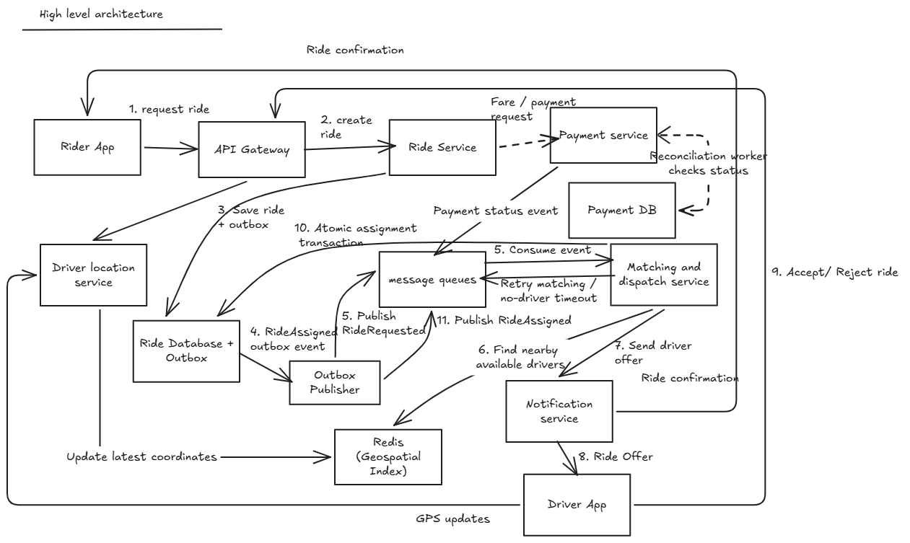

# Design a Uber / Ride-Sharing System

## 1. Clarifying Questions

1. Can a rider have multiple active rides?
   - A rider can have only one active ride at a time.

2. Which vehicle categories are supported?
   - Support Sedan and XL initially, with an extensible vehicle-category model.

3. Is ride pooling supported?
   - No. Each ride request is served independently; pooling is out of scope.

4. How is the fare determined?
   - The system calculates an estimated fare based on the ride details and displays it before booking. No bargaining.

## 1.1 Functional Requirements

- Riders can request a ride by specifying pickup and drop-off locations.
- Riders can view available vehicle categories and estimated fares before booking.
- The system matches ride requests with eligible, available drivers.
- Drivers can accept or reject ride offers.
- The system ensures that at most one driver is assigned to a ride at a time.
- Riders can track their assigned driver's location, ride status, and estimated arrival time (ETA).
- Drivers can update their availability and share their location while online.
- The system supports the ride lifecycle: requested, assigned, in progress, completed, and cancelled.
- If matching fails or an assigned driver cancels before pickup, the system can retry matching or notify the rider when no driver is available.
- Riders can cancel rides, subject to the applicable cancellation policy.
- The system processes ride payments using supported methods such as UPI, wallets, and cash.
- Payment processing must prevent duplicate charges and handle retries safely.
- Riders can rate completed rides and report issues.

## 1.2 Non-Functional Requirements

- **High Availability:** Riders should be able to request rides, and drivers should be able to receive ride offers, despite individual service failures.
- **Correctness:** At most one driver can be assigned to a ride at any point in time, even when multiple drivers accept concurrently.
- **Consistency:** Ride assignment and ride-state transitions must preserve correctness. Driver location updates can be eventually consistent.
- **Low Latency:** Ride requests, driver matching, and location updates should complete quickly enough to provide a responsive user experience.
- **Scalability:** The system should handle millions of riders and drivers across multiple cities.
- **High Throughput:** The system should process large volumes of ride requests and frequent driver-location updates.
- **Burst Handling:** The system should handle sudden traffic spikes without overwhelming downstream services.

## 2. Scale Estimation

### Rider Assumptions

- Total registered users - 10 million
- Daily active users - 1 million        (800K riders + 200K drivers)
- Average ride requests per active rider per day:  10
- Peak traffic multiplier- 5x
- Peak concurrent riders: 10% of daily active riders

### Driver Assumptions

- Daily active riders: 800,000
- Daily active drivers: 200,000
- Peak online drivers: 10% of daily active drivers
- Driver location update interval: 1 second

### Request Estimation

- Total ride requests/day = 1M × 10 = 10M
- Average ride request QPS = 10M / 86,400 ≈ 116
- Peak ride request QPS = 116 × 5 ≈ 580 QPS
- Peak concurrent riders = 10% of daily active riders = 10% of 800000 = 80,000

### Driver Estimation

- Peak online drivers = 10% × 200,000 = 20,000
- Peak driver location update QPS = 20,000 × 1 = 20,000 updates/second

### Storage Estimation

- Assumed average ride record size: 1 KB
- Raw ride storage/day: 10M × 1 KB = 10 GB
- Raw ride storage/year: 10M × 365 × 1 KB = 365 GB
- Excludes indexes, replication, database overhead, and other entities.

## 3. API Design

### Core APIs

| Action | API | Purpose |
| --- | --- | --- |
| Estimate fare | `GET /fare-estimates` | Calculate estimated fares for vehicle categories |
| Request ride | `POST /rides` | Create a ride request and initiate matching |
| Get ride status | `GET /rides/{rideId}` | Retrieve ride status, assigned driver, and ETA |
| Cancel ride | `POST /rides/{rideId}/cancel` | Cancel a ride according to policy |
| Accept offer | `POST /rides/{rideId}/accept` | Accept a ride offer |
| Reject offer | `POST /rides/{rideId}/reject` | Reject a ride offer |
| Update location | `PUT /drivers/me/location` | Publish the driver's latest location |
| Update availability | `PUT /drivers/me/availability` | Go online or offline |
| Start ride | `POST /rides/{rideId}/start` | Transition ride to in-progress |
| Complete ride | `POST /rides/{rideId}/complete` | Complete the ride |
| Submit rating | `POST /rides/{rideId}/rating` | Rate a completed ride |
| Process payment | `POST /rides/{rideId}/payment` | Process ride payment |

### Important Design Decisions

- Separate fare estimation from ride booking.
- Use idempotency keys to prevent duplicate ride creation on retries.
- Use atomic conditional updates to ensure only one driver is assigned per ride.
- Keep driver location updates separate from ride APIs.
- Store the latest driver location for real-time matching; historical storage is optional.
- Enforce one active ride per rider and valid ride-state transitions.

## 4. Data Modeling

- **User:** userId, name, phone, email
- **Driver:** driverId/userId, availability status
- **Vehicle:** vehicleId, driverId, vehicle type (car, bike, auto), category (Sedan, XL, extensible)
- **Ride:** rideId, riderId, driverId, pickup, drop, fare, status, idempotency key
- **Payment:** paymentId, rideId, amount, method, status, idempotency key
- **DriverLocation:** driverId, latitude, longitude, updatedAt
- **Rating/Issue:** Separate entities associated with a completed ride

### Storage Decisions

- **Ride DB:** Relational database for transactions, constraints, and atomic conditional updates.
- **DriverLocation:** Separate location store for frequent updates and nearby-driver searches.
- **Consistency:** Strong consistency for ride assignment and state transitions; eventual consistency for driver locations.
- **Driver assignment:** Atomically claim an available driver to prevent assignment to multiple active rides.
- **Driver matching:** Use **geographic indexing (geohash)** to find nearby eligible drivers, then rank by ETA and vehicle category.
- **Matching timeout:** Retry within a bounded deadline; notify the rider if no driver is found.

## 5. High level Architecture

### Architecture Diagram

## 6. Deep Dives

### 6.1 Atomic Driver Assignment

**Problem:** Multiple drivers may accept the same ride concurrently. A driver may also receive concurrent assignments for different rides.

**Solution:**

- Use an atomic conditional update to assign a ride only if its status is `REQUESTED`.
- Claim a driver only if their status is `AVAILABLE`.
- Perform both updates in a single database transaction when both records are in the same transactional database.
- Commit both changes on success; roll back both if either operation fails.
- If a conditional update affects zero rows, reject that assignment attempt.
- Use database constraints as additional protection where appropriate.

**Guarantees:**

- A ride has at most one assigned driver.
- A driver has at most one active ride.

Idempotency keys prevent duplicate processing of the same logical request. They do not independently prevent concurrent assignments.

### 6.2 Reliable Event Publishing — Transactional Outbox

**Problem:** The database transaction commits, but the service crashes before publishing the ride-assignment event.

**Solution:**

1. Update the ride and driver records in one transaction.
2. Insert a `RideAssigned` event into an Outbox table in the same transaction.
3. Commit the transaction.
4. An Outbox Publisher publishes pending events to the message queue.
5. Consumers process the events and trigger notifications.

**Failure handling:**

- If the transaction rolls back, neither the assignment nor its Outbox event is committed.
- If the publisher crashes, it resumes publishing pending events after recovery.
- If an event is published but not marked as published, it may be published again.
- Consumers must handle duplicate events idempotently.

The Outbox pattern prevents the database update and event publication from becoming an unrecoverable dual-write problem.

### 6.3 Idempotent Event Consumption

**Problem:** The same `RideAssigned` event may be delivered more than once.

**Solution:**

- Give every event a unique `eventId`.
- Maintain a durable record of processed event IDs.
- Enforce uniqueness on the event ID.
- Atomically record processing and apply corresponding database changes where possible.
- Skip events that have already been processed.

**Important:** A database constraint alone cannot guarantee exactly-once delivery to a user's device. If a notification is sent successfully but the service crashes before recording success, a duplicate notification may occur. Use provider-supported idempotency where available.

### 6.4 Driver Matching

**Candidate discovery:**

- Use Redis Geospatial Index or geohash-based indexing to find nearby drivers efficiently.
- Filter candidates by vehicle category, availability, and location freshness.
- Use the transactional database to enforce the final assignment guarantee.

**Ranking:**

- Prefer estimated pickup ETA over straight-line distance alone.
- ETA can account for road connectivity, traffic, and the driver's current location.

**Stale locations:**

- Store a timestamp with each driver location update.
- Reject older updates so they cannot overwrite newer locations.
- Make the timestamp comparison and location update atomic.
- If a location is too stale, temporarily exclude the driver or wait briefly for a fresh update.
- Do not wait indefinitely for a location refresh.

**No eligible drivers:**

- Expand the geographic search radius progressively.
- Bound the number of attempts and total matching time.
- Respect a maximum acceptable pickup ETA.
- Notify the rider if no suitable driver is found within the matching deadline.

### 6.5 Driver Location Update Ordering

Each location update includes the driver ID, coordinates, and timestamp.

**Rule:**

- Incoming timestamp newer than the stored timestamp: accept the update.
- Incoming timestamp older than or equal to the stored timestamp: ignore it.

The timestamp comparison and location update must happen atomically. Redis Lua scripting is one way to enforce this.

### 6.6 Location Storage

- Store the latest driver location in Redis for matching.
- Keep transactional ride and payment data in their respective databases.
- Avoid writing every GPS update to the primary Ride DB.
- Persist historical location data only if required for analytics, auditing, or trip replay.
- Treat driver location freshness and authoritative driver assignment state as separate concerns.

### 6.7 Payment Idempotency and Reconciliation

**Problem:** A payment gateway may successfully charge a rider, but the response can time out.

**Solution:**

- Create a durable payment record before initiating the external payment operation.
- Use a stable idempotency key for retries of the same logical payment.
- Pass the idempotency key to the payment provider when supported.
- Never assume that a timeout means the payment failed.
- Query the provider using its transaction ID or merchant reference when available.
- Reconcile unresolved payments instead of blindly charging again.

**Payment states:**

- `PENDING`
- `SUCCESS`
- `FAILED`
- `PENDING_RECONCILIATION`

A reconciliation worker periodically checks unresolved payments and updates the existing payment record.

If the provider is temporarily unavailable, preserve the unresolved state and retry status checks with backoff. Do not mark a payment as failed solely because its status cannot be checked.

Before allowing another payment attempt, account for the possibility that the original payment may eventually succeed.

**Provider limitation:** If the provider supports neither idempotent charging nor reliable transaction-status lookup or reconciliation, duplicate-charge prevention cannot be guaranteed solely by the application.

## 7. Bottlenecks and Trade-offs

### 7.1 Driver Location Update Overload

- Coalesce pending updates by driver ID; retain only the latest update.
- Apply atomic timestamp checks to reject out-of-order updates.
- Use backpressure and bounded queues to prevent overload.
- Trade-off: Intermediate locations are discarded, but matching needs only the latest location.

### 7.2 Stale Driver Locations

- Store a timestamp with each driver location.
- Exclude locations older than a configured freshness threshold.
- Optionally wait briefly for a fresh update; otherwise, try the next candidate.
- Trade-off: Strict freshness improves ETA accuracy but may reduce driver availability.

### 7.3 Redis Overload or Outage

- Use a circuit breaker to stop repeated calls to an unhealthy Redis cluster.
- Keep eligible rides in `REQUESTED` state and retry matching asynchronously.
- Use bounded queues, deadlines, and rate-limited retries.
- Resume processing gradually after recovery.
- Avoid overloading the primary Ride DB with fallback location queries.
- Trade-off: Queuing preserves requests but increases matching latency.

### 7.4 Matching Backlog

- Rate-limit queue consumers according to Redis capacity.
- Scale workers horizontally without exceeding Redis capacity.
- Check ride status before matching; skip cancelled or already-assigned rides.
- Trade-off: Conservative draining protects Redis but delays assignments.

### 7.5 Duplicate Queue Processing

- Treat the Ride DB as the source of truth.
- Atomically update ride assignment and processing state in one transaction.
- Acknowledge queue messages after the transaction commits.
- On redelivery, check the committed ride state and skip completed work.
- Use conditional updates to prevent duplicate assignments.
- Trade-off: At-least-once delivery with idempotent processing is practical; exactly-once delivery should not be assumed.

## 8. Reliability

### 8.1 Ride DB Unavailability

- Do not confirm ride creation or driver assignment until the database transaction commits.
- The transactional outbox cannot accept new events when its database transaction cannot commit.
- Return a retryable error or use a separate durable intake mechanism if temporary request acceptance is required.
- Retry failed operations safely after recovery.

### 8.2 Duplicate Requests and Assignments

- Use idempotency keys to identify retries of the same logical operation.
- Check the committed ride state and assigned driver before returning a retry result.
- Use atomic conditional updates and database constraints to prevent conflicting assignments.
- Return the previous successful result when the same operation already succeeded.

### 8.3 Database Recovery

- Use a circuit breaker to limit calls while the database is unhealthy.
- Apply exponential backoff with jitter to spread retries.
- Rate-limit incoming traffic and gradually increase throughput after recovery.
- Monitor database latency, saturation, error rate, retry rate, and queue depth.
- Reduce traffic if latency or errors rise sharply.

### 8.4 Key Principle

- Preserve correctness first; temporary unavailability is preferable to confirming an uncommitted ride assignment.
- Recover gradually to avoid cascading failures.

## 9. Observability

### 9.1 Metrics

- Track end-to-end ride-matching latency (p50, p95, p99).
- Monitor request throughput, success rate, and failure rate.
- Redis: latency, saturation, connection errors, and geospatial query latency.
- Ride DB: query latency, connection pool saturation, and transaction failures.
- Queue: depth, oldest message age, processing latency, retries, and DLQ size.
- Workers: CPU, memory, concurrency, throughput, and failure rate.

### 9.2 Distributed Tracing

- Propagate trace context across services and asynchronous queue messages.
- Trace the request through Ride Service, Matching Service, Redis, Ride DB, and Notification Service.
- Measure the duration of each stage to identify latency bottlenecks.
- Include rideId and traceId for correlation.

### 9.3 Structured Logging

- Log important state transitions, matching failures, retries, timeouts, and assignment conflicts.
- Include rideId, traceId, service name, and operation ID.
- Avoid logging sensitive rider or payment information.

### 9.4 Alerts

- Alert on elevated p95/p99 matching latency and error rates.
- Alert on growing queue depth and oldest message age.
- Alert on Redis or Ride DB saturation and connection failures.
- Alert on excessive retries, circuit-breaker activation, and DLQ growth.

### 9.5 Key Principle

- Metrics tell us what is wrong.
- Distributed traces show where the request was delayed.
- Logs help explain why it happened.
