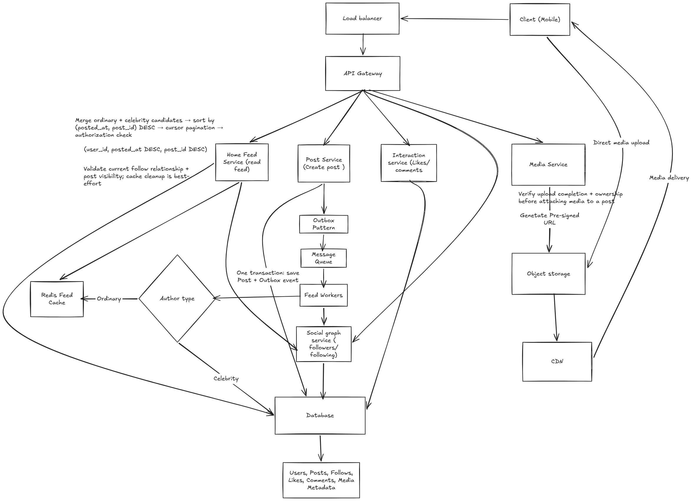

# Design Social Media Feed like Twitter, Instagram

Design the home feed for a Twitter/Instagram-like application.

## 1. Clarifying Questions

| Question | Assumption / Answer |
| --- | --- |
| Are accounts public or private? | Support both public and private accounts. |
| What types of posts are supported? | Text, images, videos, and GIFs. |
| How should the feed be sorted? | Reverse chronological order (newest posts first). |
| Are likes and comments required? | Support likes and comments on posts. |
| Are follow requests required? | Yes, private accounts require approval before following. |
| How fresh should the feed be? | New posts should appear within a few seconds. |

### 1.1 Functional Requirements

#### In Scope

- Users can follow and unfollow other users.
- Users can send follow requests to private accounts; account owners can accept or reject them.
- Users can create posts containing text, images, videos, and GIFs.
- Users can like and unlike posts.
- Users can comment on posts.
- Users can view a home feed containing posts from accounts they follow.
- The feed displays posts in reverse chronological order (newest first).
- Users can paginate through older feed items.
- Users can only view posts they are authorized to access.

#### Out of Scope

- Algorithmic feed ranking and personalized recommendations.
- Direct messaging and chat.
- Notifications for likes, comments, and new followers.
- Search, hashtags, and trending topics.
- Detailed comment-system design.
- Video processing and media transcoding internals.

### 1.2 Non-Functional Requirements (NFRs)

- **Low Latency:** The home feed should load quickly when a user opens or refreshes it.
- **High Throughput & Burst Handling:** The system should handle a large number of feed requests and sudden traffic spikes without significant performance degradation.
- **High Availability:** The feed should remain accessible even if individual servers or services fail.
- **Feed Freshness:** Newly published posts should appear in followers' feeds within a few seconds of refreshing.
- **Global Accessibility:** Users should be able to access the system from different geographical regions with good response times.
- **Durability:** Published posts should not be lost due to server failures.

## 2. Scale estimation

### 2.1 Assumptions

- Total registered users = 50M
- Daily active users = 10M (including posting, commenting, liking, following/uploading)
- Avg feed request per active user per day  = 10
- Peak traffic multiplier = 10x
- Average posts created per DAU per day = 0.2
- Average post metadata size = 1 KB
- 20% of posts contain media
- Each media-containing post has 1 image
- Average image size = 2 MB

### 2.2 Feed-read QPS

- Total feed request per day =  10M*10 = 100M
- Avg Request per second =  100M /86400 = 1158 QPS
- Peak Feed request = 1158*10 = 11580 QPS

### 2.3 Post-write QPS

- Total post = 10M*0.2 = 2M
- Avg post creation = 2M/86400 =  23 post/sec
- Peak post traffic = 23*10 = 230 QPS

### 2.3 Storage Estimation

### Post Metadata

- Daily metadata storage = 2M × 1 KB ≈ 2 GB/day

### Image Storage

- Images uploaded per day = 2M × 20% × 1 = 400,000
- Daily image storage = 400,000 × 2 MB = 800,000 MB ≈ 800 GB/day

### Storage Notes

- Store post metadata in a database.
- Store images and videos in object storage; keep their references in the database.
- Use a CDN to cache and deliver media efficiently.
- Estimates exclude replication, indexes, thumbnails, and other storage overhead.
- Estimates assume a constant posting rate and that stored content is retained.

### 5-Year Storage Estimation

Assuming a constant posting rate and retaining all content for 5 years (365 days/year):

- Post metadata = 2 GB/day × 365 × 5 = 3,650 GB ≈ 3.65 TB
- Image storage = 800 GB/day × 365 × 5 = 1,460,000 GB ≈ 1.46 PB

## 3. API Design

### 3.1 Fetch home feed API

**Request**:
**GET** `/feed?limit=5&cursor=<opaque_cursor>`

**Response**: HTTP 200 OK

```json

{
    "posts": [
        {
            "feed_id": "F1",
            "user_id": "Sanjana",
            "likes_count": "323",
            "post_id": "P-123",
            "content": "Hello world!",
            "posted_at": "2026-10-13T21:40:00Z",
            "comments_count": 100
        }
    ],
    "next_cursor": "<opaque_cursor>"
 
}
```

**Design decisions:**

- Use cursor-based pagination instead of offset-based pagination because new posts arriving at the beginning of the feed can cause duplicates or skipped posts with offset pagination.
- The backend enforces authorization before returning private posts. Cached feed entries must not bypass access-control checks.
- Posts are returned in reverse chronological order (newest first).

### 3.2 Create Post API

**POST** `/posts`

**Request**:

```json
{
    "content": "Hi",
    "media_id":  ["M-101", "M-102"]
}
```

**Response**: HTTP 201 Created

```json

{
    "post_id": "P24",
    "posted_at" :  "2026-10-13T21:40:00Z",
}
```

**Design decisions:**

- **Authentication:** The backend derives user_id from the authentication token instead of trusting a client-supplied user ID.
-**ID and timestamp generation:** The backend generates post_id and posted_at.
- **Media handling:** Media is uploaded separately to object storage. The post stores references to media IDs rather than raw storage URLs.
- **Authorization:** The backend verifies that the authenticated user owns or is authorized to associate the referenced media with the post.
- **Idempotency:** The client sends an idempotency key. Repeated requests with the same key and user return the original result instead of creating duplicate posts.
- **Consistency**: The post record and its media references must be persisted successfully before returning 201 Created. Media upload itself is a separate operation.

### 3.3 Follow Management APIs

| Endpoint | Purpose |
| --- | --- |
| `POST /users/{user_id}/follow` | Follow a public account or request to follow a private account |
| `DELETE /users/{user_id}/follow` | Unfollow an account |
| `POST /follow-requests/{request_id}/accept` | Accept a pending request |
| `POST /follow-requests/{request_id}/reject` | Reject a pending request |

**POST** `/users/{user_id}/follow`

**Behavior:**

- Public account: Create the follow relationship immediately.
- Private account: Create a pending follow request; establish the relationship only after approval.

**Response:**

- `200 OK`: The follow action succeeded or a follow request was created. The response body indicates the resulting state.

**Design decisions:**

- Derive the requesting user's identity from the authentication token.
- Prevent duplicate follow relationships and duplicate pending requests using database constraints.
- Only the owner of a private account can accept or reject its follow requests.

**DELETE** `/users/{user_id}/follow`

**Behavior:**

- Remove the follow relationship if it exists.
- Repeated requests leave the account unfollowed.

**Response:**

- `204 No Content`: The account is no longer followed.

**Design decisions:**

- Derive the requesting user's identity from the authentication token.
- Ensure the operation is idempotent.

**POST** `/follow-requests/{request_id}/accept`

**Behavior:**

- Accept a pending follow request.
- Create the follow relationship and mark the request as accepted.

**Response:**

- `200 OK`: Request accepted successfully.

**Design decisions:**

- Only the owner of the target private account can accept the request.
- Only pending requests can be accepted.
- Ensure the request status update and follow relationship creation are atomic.

**POST** `/follow-requests/{request_id}/reject`

**Behavior:**

- Mark the pending follow request as rejected.
- Do not create a follow relationship.

**Response:**

- `200 OK`: Request rejected successfully.

**Design decisions:**

- Only the owner of the target private account can reject the request.
- Only pending requests can be rejected.
- Ensure concurrent accept/reject operations cannot both succeed.

### 3.4 Post Interactions API

#### Like a Post

**POST** `/posts/{post_id}/like`

**Response**: HTTP 201 Created

```json
{
  "post_id": "P-123",
  "status": "liked"
}
```

**Design decisions:**

- Derive `user_id` from the authentication token.
- Enforce a unique constraint on `(user_id, post_id)` to prevent duplicate likes.
- Make the operation idempotent: retries should not create duplicate likes and should be treated as successful if the like already exists.
- Verify that the post exists and the user is authorized to view it.

#### Unlike a Post

**DELETE** `/posts/{post_id}/like`

**Response**: HTTP 204 No Content

**Design decisions:**

- Remove the like belonging to the authenticated user.
- Make the operation idempotent so repeated requests leave the post unliked.

#### Comment on a Post

**POST** `/posts/{post_id}/comments`

**Request:**

```json
{
  "content": "Nice post!"
}
```

**Response**: HTTP 201 Created

```json
{
  "comment_id": "C-101",
  "post_id": "P-123",
  "created_at": "2026-10-13T21:40:00Z"
}
```

**Design decisions:**

- Derive the comment author's `user_id` from the authentication token.
- Generate `comment_id` and `created_at` on the backend.
- Use an idempotency key to prevent duplicate comments on retries.
- Verify post visibility and authorization before accepting the comment.

### 3.5 Media Upload API

**POST** `/media/uploads`

**Request:**

```json
{
  "file_name": "photo.jpg",
  "content_type": "image/jpeg"
}
```

**Response**: HTTP 201 Created

```json
{
  "media_id": "M-101",
  "upload_url": "<pre-signed-upload-url>",
  "status": "PENDING"
}
```

**Upload flow:**

1. Client requests a media upload from the backend.
2. Backend generates a `media_id` and a pre-signed upload URL for object storage.
3. Client uploads the media directly to object storage using the URL.
4. Backend verifies upload completion before allowing the media to be associated with a post.
5. Client creates a post using `POST /posts`, including the associated `media_ids`.

**Design decisions:**

- Store media files in object storage (e.g., Amazon S3), not in the application database.
- Store media metadata and storage references in the database.
- Use an idempotency key to handle retries of upload-initiation requests.
- Clean up abandoned, unassociated uploads after a retention period.
- Enforce file-size/type limits and verify that uploaded media belongs to the authenticated user.

## 4. Data Modelling

Users
    - user_id            (PK)
    - user_name
    - follower_count
    - post_counts
    - following_count
    - account_visibility  (PUBLIC, PRIVATE)

Follow
    - follower_id       (PK, FK -> Users.user_id)
    - followee_id       (PK, FK -> Users.user_id)
    - created_at

**Constraints:**

- Composite primary key: (follower_id, followee_id)
- Prevent a user from following themselves.
- Create a follow relationship only when the target account is public or a private account's follow request has been accepted.

FollowRequest
    - request_id (PK)
    - requestor_id (FK -> Users.user_id)
    - target_user_id (FK -> Users.user_id)
    - status (PENDING, ACCEPTED, REJECTED)
    - created_at
    - updated_at

**Constraints:**

- Prevent duplicate pending requests for the same requestor and target.
- Only the owner of the target account can accept or reject a request.
- Accepting a request must atomically update its status and create the corresponding Follow relationship.

Post
    - post_id           (PK)
    - user_id           (FK -> Users.user_id)
    - content
    - media_type
    - likes_count
    - comments_count
    - posted_at

Like
    - user_id  (PK, FK -> Users.user_id)
    - post_id  (PK, FK -> Post.post_id)
    - created_at

**Constraints:**

- Composite primary key: (user_id, post_id).
- A user can like a post only once.
- Unlike removes the corresponding record.

Comment
    - comment_id  (PK)
    - post_id     (FK -> Post.post_id)
    - user_id     (FK -> Users.user_id)
    - content
    - status      (optional)
    - created_at

Media
    - media_id      (PK)
    - user_id       (FK -> Users.user_id)
    - file_name
    - storage_key
    - media_type
    - status
    - created_at

PostMedia
    - post_id   (PK, FK -> Post.post_id)
    - media_id  (PK, FK -> Media.media_id)
    - position

**Constraints:**

- Composite primary key: (post_id, media_id).
- `position` determines the display order of media attached to a post.
- Enforce unique (post_id, position) if each position must identify exactly one media item.

## 5. High level architecture

### Architecture Diagram



## 6. Deep Dives

### 6.1 Post Creation and Reliable Event Publishing

- The Post Service saves the post and an outbox event in the same database transaction.
- An Outbox Publisher asynchronously publishes pending events to the message queue.
- If the queue is unavailable, the event remains in the outbox and can be retried without losing the post.
- Feed Workers consume events and distribute posts to followers' feeds.
- Assume at-least-once message delivery; consumers must handle duplicate processing idempotently.

### 6.2 Hybrid Fan-out Strategy

Use a hybrid approach to balance feed-read latency and post-distribution cost.

- **Fan-out on write:** For ordinary users, Feed Workers push post IDs into followers' Redis feed caches when a post is published. This makes feed reads faster but increases write work.
- **Fan-out on read:** For celebrity accounts with a large number of followers, avoid pushing each post to every follower. Retrieve their recent posts when a follower requests the feed.
- **Feed assembly:** Merge ordinary-user feed entries with recent posts from celebrity accounts, then sort by `(posted_at, post_id)` in descending order.
- The fan-out strategy can depend on follower count, posting frequency, and system load rather than a fixed threshold.

### 6.3 Feed Caching

- Use Redis to store feed entries as post IDs rather than duplicating complete post metadata for every follower.
- A Redis Sorted Set (ZSET) orders feed entries by timestamp and prevents duplicate members within a user's feed.
- Use the original, immutable `posted_at` timestamp as the score so retries do not move posts to the top.
- Cache frequently accessed post metadata separately to reduce repeated database reads.
- Use the database as the durable source of truth for post data.

### 6.4 Cursor-based Pagination

- Use cursor-based pagination instead of offset-based pagination to reduce duplicates and skipped items caused by new posts shifting the feed.
- The cursor contains the last returned post's ordering position, based on `(posted_at, post_id)`.
- Fetch the next page strictly after that position in descending feed order.
- Use `post_id` as a tie-breaker when multiple posts have the same timestamp.
- Recheck post visibility because deletions and permission changes can occur between page requests.

### 6.5 Cache Invalidation and Authorization

- When a post is deleted, invalidate its cached metadata and attempt to remove its ID from feed caches.
- Cache invalidation is best-effort; stale entries may remain if Redis is unavailable.
- Check current post status and viewer authorization before returning feed items.
- After an unfollow, remove the author's posts from the follower's feed cache.
- If cache cleanup fails, enforce the current follow relationship and post visibility rules before returning posts.

### 6.6 Feed Freshness and Consistency

- Feed distribution is asynchronous, so a newly published post may not immediately appear in every follower's Redis feed.
- For recent posts missing from the precomputed feed, the Feed Service can fetch recent posts from followed accounts and merge them into the feed.
- Use a composite index such as `(user_id, posted_at DESC, post_id DESC)` to retrieve recent posts efficiently for a given author.
- Keep feed results sorted by `(posted_at, post_id)` in descending order.
- The feed may be eventually consistent, but newly published posts should become visible within the specified freshness target.

### 6.7 Media Upload and Delivery

- The client uploads media directly to object storage using a pre-signed URL.
- Media upload initiation should be idempotent so retries can reuse the same logical upload.
- Before creating a post that references media, verify upload completion, object existence, and media ownership.
- Track media status, such as `PENDING` and `UPLOADED` or `VERIFIED`, before allowing it to be attached to a post.
- Store media metadata and storage references in the database, not the media bytes themselves.
- Use a CDN to deliver images and videos efficiently.
- Clean up abandoned uploads after a retention period.

## 7. Bottlenecks & Trade-offs

### 7.1 Fan-out Bottleneck

- Fan-out on write creates many feed-cache writes for users with large follower counts.
- Fan-out on read reduces write amplification but increases feed-read computation.
- Use a hybrid strategy: fan-out on write for ordinary users and fan-out on read for celebrity accounts.

### 7.2 Redis and Database Load

- Redis reduces feed-read latency and database load, but a cache outage can cause a surge in database requests.
- Use rate limiting, concurrency limits, circuit breakers, and graceful degradation to protect the database.
- Recover Redis and rebuild missing feed entries asynchronously instead of rebuilding everything synchronously.
- Horizontal database scaling and sharding may help as sustained traffic and data volume grow, but they are not immediate substitutes for cache-outage protection.

### 7.3 Caching Trade-offs

- Caching feed IDs reduces read latency but requires invalidation and recovery mechanisms.
- Caching post metadata reduces repeated database reads but can serve stale data.
- Enforce post visibility and deletion rules even when cached entries exist.

### 7.4 Queue Lag and Worker Saturation

- If event arrival rate exceeds processing capacity, queue depth and message age increase, delaying feed updates.
- Monitor queue depth, oldest-message age, worker utilization, processing latency, and retry/failure rates.
- Scale Feed Workers horizontally when worker capacity is the bottleneck.
- If Redis or the database is saturated, adding more workers can worsen the bottleneck. Control worker concurrency and address downstream capacity first.
- Partition the queue when needed to increase parallelism, while preserving required ordering.

### 7.5 Celebrity Hot Keys and Cache Stampedes

- Celebrity posts can generate a large number of simultaneous reads, overloading Redis or the database.
- Cache frequently accessed post metadata and use CDN caching for media delivery.
- Use request coalescing or single-flight so concurrent cache misses share one database fetch.
- Scale read capacity and distribute traffic when sustained demand exceeds a single cache or database node.

### 7.6 Feed Assembly Cost

- Merging ordinary-user feed entries with celebrity posts increases read-side computation.
- Fetch bounded sets of recent posts, use indexed queries, and apply timeouts to avoid slow sources delaying the entire feed.
- Avoid querying every followed celebrity individually on every request; use batching or cached recent-post candidates where appropriate.
- Balance bounded work and low latency against the risk of missing relevant posts when too few candidates are fetched.

## 8. Reliability

### 8.1 Redis Failure

- Redis is a cache; the database remains the source of truth.
- Avoid sending all feed requests to the database during a Redis outage.
- Use circuit breakers, rate limiting, concurrency limits, and bounded queues to protect the database.
- Gracefully degrade by returning a limited feed or safe stale data when possible; otherwise, return an appropriate error.
- Use the half-open circuit-breaker state to probe recovery before restoring normal traffic.

### 8.2 Message Queue and Worker Failures

- Retry transient failures with exponential backoff and a maximum retry limit.
- Move repeatedly failing messages to a dead-letter queue (DLQ) for investigation and controlled replay.
- Scale Feed Workers and partition the queue when additional parallelism is needed.
- Apply backpressure and gradually increase processing throughput during backlog recovery to avoid overloading Redis or the database.

### 8.3 Duplicate Event Processing

- Assume at-least-once message delivery; consumers must handle duplicate events safely.
- Use idempotent operations. Redis Sorted Sets prevent duplicate feed entries when `post_id` is the member.
- Use the original `posted_at` timestamp as the score so retries do not change feed ordering.

### 8.4 Authorization During Cache Failures

- Cache invalidation is best-effort; stale entries may remain after an unfollow or post deletion.
- Always enforce current follow relationships, account visibility, and post status before returning feed items.
- Cached entries must never bypass authorization checks.

### 8.5 Recovery and Availability

- Recover gradually after an outage instead of releasing the entire queued backlog at once.
- Use timeouts, bounded concurrency, and load shedding when downstream capacity is constrained.
- Monitor recovery progress and restore normal traffic only when dependencies can handle the load.
- Maintain database backups and tested recovery procedures to protect durable data.

## 9. Observability

- Monitor Feed API request rate, p95/p99 latency, error rate, and timeouts.
- Monitor queue depth, oldest-message age, event arrival rate, and consumer throughput.
- Track Feed Worker processing latency, success/failure rate, retries, and resource utilization.
- Monitor Redis latency, error rate, cache hit ratio, and resource utilization.
- Monitor database query latency, connection pool utilization, and connection acquisition timeouts.
- Track feed freshness: time from post creation to availability in followers' feeds.
- Use structured logs, correlation IDs, and distributed tracing to troubleshoot failures across services.
- Configure alerts for feed latency/errors, growing queue lag, worker failures, Redis errors, and database saturation.
- Correlate queue lag, worker throughput, and downstream health to identify bottlenecks
