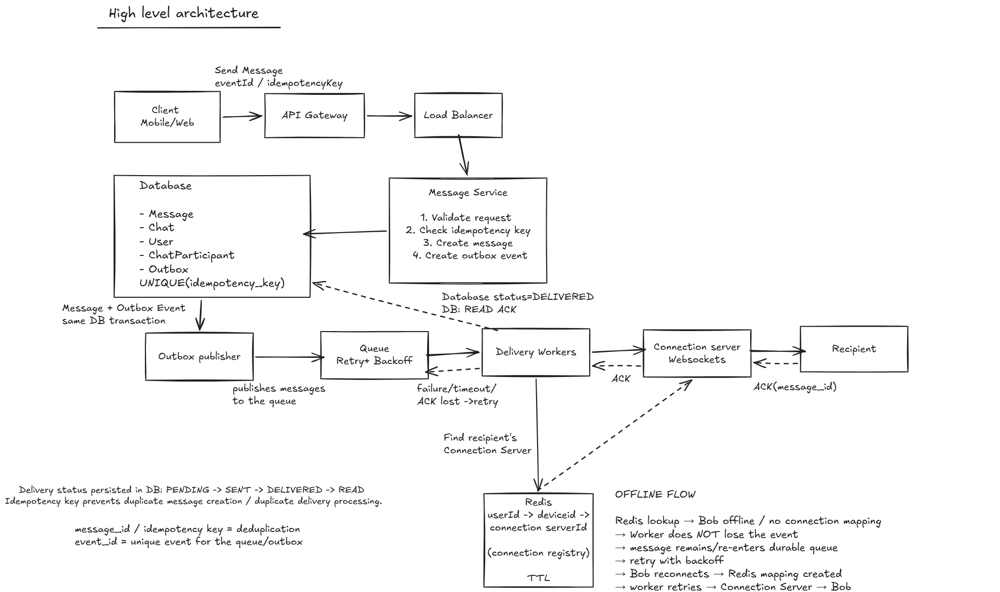

# Design a Whatsapp System

Design a simplified WhatsApp-like messaging system.
Users should be able to send messages to other users and receive them reliably.

## 1. Clarifying Questions

1. Should we focus on 1:1 messaging first, or include groups?
2. Should media (images/videos/documents) be in scope?
3. Should we include push notifications?
4. Should multi-device support be in scope?
5. Should voice/video calls be in scope?
6. What level of message reliability/delivery guarantee is expected?

### 1.1 Functional Requirements

- User can send 1:1 messages.
- User can send messages in groups.
- Messages can be delivered even when the recipient is offline.
- System tracks message status:
  - ✓ Sent — server has durably persisted the message.
  - ✓✓ Delivered — recipient's device acknowledges receipt.
  - Blue ✓✓ Read — recipient has read the message.
- System should prevent duplicate messages when delivery is retried.
- User can send media such as images, videos, GIFs, and documents.
- System sends push notifications when appropriate.
- User can use multiple devices.

### 1.2 Non - Functional Requirements

- High Availability - system should continue operating despite component failures.
- Reliable Delivery - messages should not be lost.
- At-least-once delivery with deduplication.
- End-to-end encryption.

## 2. Scale Estimation

### Assumptions

- Total users = 50M
- Daily Active Users (DAU) = 10M
- Messages per active user per day = 20
- Peak traffic multiplier = 3×
- Peak concurrent online users = 10% of DAU = 1M
- Average msg size =  1KB

### Traffic Estimation

- Total messages/day = 10M × 20 = 200M
- Average QPS = 200M / 86,400 ≈ 2,315 QPS
- Peak QPS = 2,315 × 3 ≈ 6,945 QPS
- Peak concurrent connections ≈ 1M
- Raw message storage = 200M*1KB = 200 GB/day

## 3. API Design

### 3.1 Send Message

**POST** `/messages`

**Request**:

```json
{
  "message_id": "M1",
  "receiver_id": "Bob",
  "message": "Hi, How are you"
}
```

**Response**:
HTTP 202 Accepted

```json

{
  "message_id": "M1",
  "status": "accepted",
  "sent_at": "2026-10-03T14:45:00Z"
}
```

Notes:

- sender_id comes from authentication.
- message_id is generated by the client.
- Same message_id is reused on retries for deduplication.

### 3.2 Delivering message API

**POST** `/message/{message_id}/ack`

**Request**:

```json
{
   "status": "Delivered"
}
```

**Response:**

HTTP 200 OK

```json
{
    "message_id": "M1",
    "status": "Delivered",
    "delivered_at": "2026-10-03T14:45:00Z"
}
```

### 3.3 Read Receipt API

**POST** `/message/{message_id}/read`

**Request**:

```json
{
   "status": "READ"
}
```

**Response:**

HTTP 200 OK

```json
{
    "message_id": "M1",
    "status": "READ",
    "read_at": "2026-10-03T15:45:00Z"
}
```

## 4. Data Modelling

### User

- `user_id` (PK)
- `user_name`
- `phone_number` (UNIQUE)
- `last_seen`
- `status`

### Chat

- `chat_id` (PK)
- `chat_type` (`1:1`, `GROUP`)
- `created_at`

### ChatParticipant

- `chat_id` (PK)
- `user_id` (PK)
- `joined_at`
- `left_at`

Composite Primary Key: `(chat_id, user_id)`

### Message

- `message_id` (PK)
- `chat_id`
- `sender_id`
- `sent_at`
- `message`
- `message_type` (`TEXT`, `IMAGE`, `VIDEO`, `DOCUMENT`)
- `created_at`
- `idempotency_key` (UNIQUE)

Index: `(chat_id, sent_at, message_id)`

The `idempotency_key` prevents duplicate message creation when
the client retries the same request.

### MessageRecipient

- `message_id` (PK)
- `recipient_id` (PK)
- `delivered_at`
- `read_at`

Composite Primary Key: `(message_id, recipient_id)`

Used to track per-recipient delivery and read status,
especially for groups.

### Outbox

- `event_id` (PK)
- `message_id`
- `event_type`
- `created_at`
- `published_at`

The `Message` and `Outbox` record are created in the same
database transaction.

### Important Access Patterns

1. Fetch messages for a chat ordered by time:
   - Query using `chat_id`
   - Order by `(sent_at, message_id)`

2. Cursor-based pagination:
   - Cursor contains `(sent_at, message_id)`
   - Fetch older messages using:
     `WHERE chat_id = ? AND (sent_at, message_id) < (?, ?)`
   - `LIMIT 50`

3. Find all participants of a chat:
   - Query using `chat_id`

4. Track delivery/read status:
   - Query `MessageRecipient` using `(message_id, recipient_id)`

### Choosing the Database

- Use a relational database for the core messaging data.
- Structured relationships exist between users, chats, messages,
  and participants.
- Transactions provide data integrity for important operations.
- The main message-history access pattern is:
  `chat_id + sent_at`.

At ~200M messages/day, a single database instance may not be
sufficient, so partitioning/sharding should be introduced as
the system grows.

### Message Indexing

For the primary access pattern:

- Composite index: `(chat_id, sent_at, message_id)`
- `chat_id` filters messages for the conversation.
- `sent_at` provides chronological ordering.
- `message_id` provides a deterministic tie-breaker.

This also supports cursor-based pagination.

### Sharding Trade-off

- Initially shard messages by `chat_id`.
- This keeps messages for a conversation together and matches
  the primary access pattern.
- A very large or active chat can create a hot partition.
- If hot partitions become a bottleneck, introduce a more
  sophisticated partitioning strategy.

## 5. High level architecture

### Architecture Diagram



## 6. Deep Dives

### 6.1 Reliability & Failure Handling

- Messages are durably persisted before being acknowledged as Sent.
- Message + Outbox event are written in the same DB transaction.
- Outbox Publisher publishes pending events to the queue.
- If publishing fails, the Outbox Publisher retries.
- Publishing can produce duplicates, so downstream processing is idempotent.
- `message_id` is the idempotency key for message creation and delivery attempts.
- Retries reuse the same `message_id`.
- Delivery uses at-least-once semantics.
- Recipient clients deduplicate messages using `message_id`.
- If the recipient is offline, the message remains pending until the recipient reconnects.
- Retries use exponential backoff where appropriate.
- Exactly-once delivery cannot be guaranteed across failures such as ACK loss/crashes.
- Use at-least-once delivery + idempotent processing to achieve effectively-once user-visible delivery.

### 6.2 Connection Management

- Redis maintains the current connection mapping:
  `user_id → connection_id → connection server`
- Connections use TTL/heartbeat to remove stale registrations.
- Reconnection creates a new connection ID.
- The latest connection becomes the active connection.
- Connection Server failure does not lose messages; clients reconnect to another server.
- When a user reconnects, the system triggers delivery of pending messages for that user.
- Redis is not the source of truth for messages; it only stores ephemeral connection state.

### 6.3 Multi-device

- User-level `delivered_at` represents delivery to at least one device.
- Other devices synchronize independently when they reconnect.
- Device-level synchronization state is separate from user-level delivery status.

## 7. Bottlenecks & Trade-offs

- Message Service → horizontally scale stateless instances.
- Database → replicas, partitioning, and eventually sharding.
- Sharding by `chat_id` preserves locality and supports the main access pattern.
- Hot chats can create hot partitions.
- Connection Servers → horizontally scale long-lived connections.
- Queue → partitions + horizontal workers.
- Queue absorbs short-term bursts; sustained overload requires scaling/backpressure.
- Per-chat ordering improves correctness but limits parallelism for a hot chat.

## 8. Observability

Monitor:

- Message delivery latency and success rate
- Queue depth and oldest-message age
- Retry rate and DLQ size
- Worker throughput and saturation
- Outbox backlog
- DB latency and read/write errors
- Active connections and connection errors
